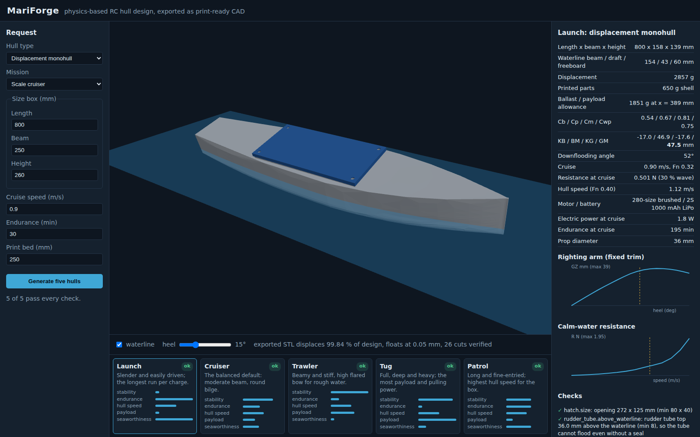

<p align="center">
  
</p>

<h1 align="center">MariForge</h1>

<p align="center"><strong>A physics-based RC boat design studio that outputs print-ready hulls.</strong><br>
Give it a size box, a cruise speed and an endurance. It solves the coupled hydrostatics ↔ weight ↔ resistance ↔ propulsion problem, hands you five genuinely different hulls, renders them on the water in 3D, and exports CAD with the rudder tube, stuffing tube, motor mount, servo thwart and a gasketed magnet hatch already in the part.</p>

<p align="center">Tell it what the boat has to carry and how rough the water is, and it also tells you <strong>where every payload goes, the biggest waves each hull can work in, what the parts cost</strong>, and hands you an <strong>ArduPilot</strong> parameter file to start from.</p>

<p align="center">
  <code>Python 3.11+</code> · <code>FastAPI</code> · <code>CadQuery / OpenCASCADE</code> · <code>trimesh</code> · <code>three.js</code> · the maritime sibling of <a href="https://github.com/stekimboy/aeroforge">AeroForge</a>
</p>

---

## What it is

MariForge follows AeroForge's doctrine: every number on screen is the output of a real calculation, and the CAD it exports is the thing you print, not a sketch of it. The difference is the medium. An airframe has to fly; a hull has to **float level at its design waterline, stay upright, stay dry and be pushed through the water efficiently**, and each of those is computed and then proven on the exported geometry.

**One request → five hulls.** Each character is an independent solve with its own hull-form coefficients, so the five differ in shape and in behaviour:

| Character | L/B | B/T | Section | What it is for |
|---|---|---|---|---|
| **Launch** | 5.2 | 3.6 | slack round bilge | slender, easily driven, longest run per charge |
| **Cruiser** | 4.2 | 3.4 | round bilge | the balanced default |
| **Trawler** | 3.5 | 3.2 | full, flared bow | beamy and stiff for rough water |
| **Tug** | 3.0 | 2.8 | near-box | full and deep, the most payload |
| **Patrol** | 4.7 | 3.8 | moderate, fine entry | highest hull speed for the box |

---

## The physics

| Quantity | How | Where |
|---|---|---|
| Hull surface | parametric sections: superellipse underwater, flared topsides, sheer | `physics/hullform.py` |
| Displacement, LCB, KB, wetted area, waterplane, BM | section integration (clip each section at the waterline, integrate along x) | `physics/hydrostatics.py` |
| Righting arm GZ to 90°, range of stability | heel the sections, re-solve the waterline for constant volume (fixed trim) | same |
| Downflooding angle | heel at which the coaming's low corner meets the heeled waterline | same |
| Resistance | ITTC-1957 friction × Holtrop-Mennen form factor, Holtrop 1984 wave resistance, transom term | `physics/resistance.py` |
| Motor, battery, endurance | effective power / (η_D · η_motor), smallest part with the headroom | `physics/design.py`, `components.py` |
| Mass and CG | printed shell from surface area × wall, printed fittings, catalogue parts | `physics/weights.py` |
| Ballast | the lead that brings the boat to its design displacement **and** puts LCG on LCB, so it floats level | same |

The draft is solved, not chosen: the hull has to displace what it weighs, the battery depends on the power, the power on the resistance, the resistance on the hull. `design.py` iterates until they agree.

Ballast beyond the 5 % trimming minimum is reported as the **spare capacity**: swap lead for cargo and the boat still floats at its lines.

### Payload first

Pick what the boat has to carry from the catalogue (autopilot + GPS, telemetry radio, FPV or action camera, companion computer, echo sounder, water-quality pack, medical resupply pouch, mesh radio relay) or add your own item with its mass, size, power and mount. Each item is a real part of the solve:

| Mount | Where it goes | What it changes |
|---|---|---|
| in the hull | packed on the cavity floor under the hatch, overflow into the forward cavity; the hatch grows (0.20 L to 0.75 L) when the payload needs it | mass, CG, ballast |
| on the hatch lid | cameras and antennas, aft to forward | mass, and KG goes up, so GM is re-checked |
| through-hull well | a flooded tube from the bottom skin to above the waterline, with a flat-bottom check for the transducer face | the well water is taken out of the displacement and LCB/KB, and its free surface (π r⁴ / 4 per well) comes off GM |

Payload power is added to the battery sizing, so endurance stays honest. An item that will not fit is a failed check with its own name (`payload.<item>`), never a silent drop. The CAD builds the well (boss bonded to the skin, bore through it) and the verifier proves it is open to the water and that the cut envelope still displaces the net design volume.

### Sea state

Each hull reports the largest significant wave height it can work in and what limits it.

| Piece | How |
|---|---|
| Heave and pitch, head seas at cruise | strip theory: Lewis-form added mass per section, waterplane restoring, Froude-Krylov excitation with the Smith depth correction, encounter frequency, damping 0.20 of critical at heave resonance (assumed, stiffness-proportional) |
| Roll, beam seas at rest | single DOF, effective wave slope (averaged across the beam, attenuated to the centre of buoyancy), k_xx = 0.40 B + 20 % added inertia, damping 0.08 (assumed) |
| Sea | Bretschneider spectrum, peak period from a steepness of 1/20 (fetch-limited chop on a lake or harbour) |
| Limits | NORDFORSK 1987 general operability: roll RMS ≤ 6°, deck wetness ≤ 5 %, keel emergence ≤ 3 %, bow vertical acceleration RMS ≤ 0.275 g; plus water reaching the hatch coaming ≤ 1 % |

Set **Must work in waves up to Hs** and it becomes a check (`seakeeping.wave_height`). These are linear estimates: good for ranking hulls and for the order of magnitude, not a tank test.

### ArduPilot and the parts list

**Download ArduPilot Rover parameters** gives a Mission Planner `.param` file for a boat frame: `FRAME_CLASS 2`, rudder and throttle outputs, `CRUISE_SPEED` from the design, `CRUISE_THROTTLE` from the cruise power against the motor's rating, turn radius, steering rate and accel/decel limits from the resistance and mass. They are starting values; run Learn Cruise and the Rover tuning steps afterwards.

The **parts list** prices every bought part, the payload, PLA (with 10 % waste) and the lead ballast, and gives a print-time range. Prices are typical hobby retail estimates in USD, not quotes.

### Checks every design reports

`ballast.positive`, `trim.level`, `stability.gm` (GM ≥ 4 % of beam), `stability.range` (GZ positive to ≥ 70°), `stability.downflooding` (≥ 35°), `seakeeping.wave_height` (when asked), `payload.<item>`, `speed.froude` (cruise Fn ≤ 0.40), `resistance.method_range`, `endurance`, `motor.headroom`, `box.height`, `box.beam`, and the hardware fits: `hatch.size`, `rudder_tube.above_waterline`, `stuffing_tube.inside`, `motor_mount.fits`, `servo_tray.fits`, `battery.fits`. The stability numbers are MariForge's own conservative choices for a free-running model, not a class rule.

---

## Hardware that comes out of the printer

| Feature | Value | Why |
|---|---|---|
| Hull wall | **1.6 mm**, four 0.4 mm perimeters | fewer than three perimeters is the usual cause of weeping FDM hulls |
| Hatch coaming | 10 mm above the highest deck point, 4 mm wall | the downflooding angle is measured to its top edge |
| Gasket groove | 1.6 × 1.2 mm on the coaming top | 1.5 mm cord or foam, ~20 % squeeze |
| Hatch magnets | four **Ø8.15 mm** bores × 3.2 mm, in corner pads and in the lid | AeroForge builder's as-cut spec, discs 0.2 mm below flush |
| Lid fit | 0.35 mm per side, 6 mm skirt outside the coaming | AeroForge printed-fit band |
| Rudder tube | Ø4.2 bore for 4 mm OD brass, boss rises above the waterline | the tube cannot flood even without a seal |
| Stuffing tube | Ø4.96 bore for 3/16" brass, 8° shaft line, boss bonded to the skin | shaft line solved from the prop position and diameter |
| Motor mount | plate square to the shaft, centre hole + two M2.5 holes on the motor's pattern | 280 / 380 / 540 can motors |
| Servo thwart | SG90 hole at **0.25 mm per face**, servo hangs from its ears | SG90 envelope from AeroForge's measured model |
| Rudder | balanced, NACA 0012, stock at 25 % chord, area 2.5 % of L·T | model rudders need more area than full-size practice (1.5–2 %) |
| Print split | hull cut into segments that fit the bed, cut planes moved off every fitting | butt-joined with epoxy |

Every printed fitting is intersected with the cavity before it is fused, so none can poke through the skin. Every cut is existence-checked afterwards.

---

## Proven on the exported geometry

`tests/test_cad.py` builds every character at the default request and checks the real output, not the builder's intent:

<!-- validation:start -->
| Hull | Design displacement | STL volume at DWL vs design | Floats at (DWL = 0) | LCB − LCG | Cuts verified | One valid watertight solid | Printed mass: CAD vs estimate | Build + verify |
|---|---|---|---|---|---|---|---|---|
| Launch | 2857 g | -0.16 % | +0.05 mm | +0.0 mm | 26/26 | yes | 811 g vs 822 g | 45 s |
| Cruiser | 5126 g | -0.06 % | +0.03 mm | -0.1 mm | 26/26 | yes | 991 g vs 1007 g | 43 s |
| Trawler | 8214 g | -0.02 % | +0.01 mm | -0.1 mm | 26/26 | yes | 1207 g vs 1215 g | 42 s |
| Tug | 11819 g | -0.04 % | +0.03 mm | -0.1 mm | 26/26 | yes | 1347 g vs 1354 g | 43 s |
| Patrol | 3698 g | -0.06 % | +0.02 mm | -0.1 mm | 26/26 | yes | 917 g vs 925 g | 44 s |
<!-- validation:end -->

---

## Quick start

```
./run.sh          # macOS / Linux
run.bat           # Windows
```

Then open http://127.0.0.1:8000, set the box, press **Generate five hulls**. The gallery and spec sheet come back in a few seconds; the full CAD with hardware builds in the background (~30 s per hull) and replaces the preview when it is verified. Download STEP or the STL set from the spec sheet.

Tests:

```
.venv/bin/python -m pytest tests/ -q --ignore=tests/test_cad.py   # physics + API
.venv/bin/python -m pytest tests/test_cad.py -q                   # full CAD builds
```

---

## Known gaps

Recorded, not hidden.

- **One hull type.** Displacement monohull only. Planing V-hull (Savitsky) and catamaran are the next milestone.
- **Fixed-trim GZ.** Heeling does not re-trim the hull. It is the standard approximation; free-trim GZ is open.
- **Model-scale friction.** The ITTC-57 line assumes turbulent flow; small hulls at low speed can run partly laminar, so resistance is likely over-predicted there. No correlation allowance is applied.
- **Propulsive efficiency is assumed** (η_D = 0.45), not computed from a prop series.
- **Seakeeping is linear and partly assumed.** Damping is a fixed fraction of critical, not a radiation solve; roll is uncoupled; the sea is a single steepness. NORDFORSK limits are full-scale criteria applied unchanged at model scale.
- **Prices are estimates.** Typical hobby retail per part class, not live quotes; custom items are not priced.
- **ArduPilot values are untested starting points.** They come from the design, not from a tuned boat.
- **Not yet validated against a tank test or a floated print.** The first physical check is to print one, float it, and measure draft and roll period against the spec sheet.
- **The print split is a plain butt joint.** Tongue-and-groove joints are open.

---

## License

MIT, © 2026 Steven Kim. Constants reused from AeroForge (the SG90 envelope, magnet bore and printed-fit bands) are the same author's work under the same license.
